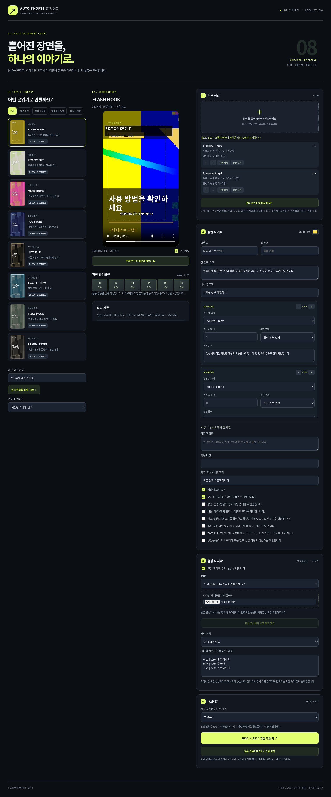

# AUTO SHORTS STUDIO

사용자 소유의 영상을 업로드하고, 8개 오리지널 스타일로 컷·문구·음성·자막을 편집해 MP4로 출력하는 로컬 숏폼 편집기입니다. 첨부 스타터의 FastAPI/FFmpeg/Pillow 렌더링과 템플릿을 유지하면서 TypeScript 편집 화면, 미디어 분석, 영속 작업 큐를 추가했습니다.



팀 공유를 위한 Vercel + Railway 설정, 로그인 없는 브라우저별 작업 공간, 현재 호스팅 저장 공간 제한은 [DEPLOYMENT.md](DEPLOYMENT.md)를 참고하세요.

## 브라우저에서 바로 테스트

[GitHub Codespaces에서 실행](https://codespaces.new/kottomkt1-byte/shorts?quickstart=1)

위 링크에서 **Create codespace**를 누르면 Python, Node, FFmpeg, 한국어 글꼴과 앱을 설치하고 편집기를 자동 실행합니다. 처음 준비하는 데 몇 분 걸립니다. 생성 후 **Ports → 8787 → Open in Browser**에서 편집기를 엽니다. 포트 공개 범위는 기본 **Private**를 유지하세요. 사용자 GitHub 로그인으로 접근하며, 외부 배포 계정은 필요하지 않습니다.

브라우저 주소는 Codespaces가 제공하는 `https://…-8787.app.github.dev` 형식입니다. `127.0.0.1`은 현재 브라우저가 실행되는 컴퓨터를 가리키므로 다른 클라우드 작업 환경의 주소로 사용할 수 없습니다. 환경을 다시 시작하면 앱도 자동 시작하며, 필요한 경우 Codespaces 터미널에서 `bash scripts/codespaces-start.sh`로 실행할 수 있습니다. 끝나면 Codespace를 중지하세요. 이용 한도와 과금은 GitHub 계정의 Codespaces 설정에 따릅니다.

## 실행

필수: **Python 3.11+, Node.js 22.12+ 또는 24+, FFmpeg/ffprobe**, 한국어 글꼴. FFmpeg에 libx264, AAC, libass(`subtitles`), `xfade`, `sidechaincompress` 필터가 필요합니다. 전체 검증용 샘플 음성 생성에는 `flite` 필터도 필요합니다.

```bash
python -m venv .venv
# macOS / Linux
source .venv/bin/activate
# Windows PowerShell: .venv\Scripts\Activate.ps1
pip install -r requirements.txt
npm install
python scripts/doctor.py
npm run dev
```

**http://127.0.0.1:5173** 에 접속합니다. `npm run dev`는 API(8787)와 Vite(5173)를 함께 시작합니다. Python 실행 파일을 바꾸려면 `PYTHON` 환경변수를 설정합니다.

Ubuntu 예: `sudo apt install ffmpeg fonts-noto-cjk`. Windows FFmpeg 예: `winget install Gyan.FFmpeg`. 글꼴을 직접 지정하려면 `AUTO_SHORTS_FONT`에 한글 지원 TTF/OTF/TTC 경로를 지정합니다. `doctor.py`가 선택한 글꼴과 필터를 보여줍니다.

빌드한 화면을 API 서버에서 제공하려면:

```bash
npm run build
npm start
# http://127.0.0.1:8787
```

`dist`를 새로 빌드하면 API 서버를 재시작하세요. 기본 주소는 로컬 루프백입니다. `.env.example`은 설정 예시이며 **자동으로 로드하지 않습니다**. 셸에서 환경변수를 export하거나 프로세스 관리 도구에 설정하세요.

## 사용 흐름

1. 8개 스타일 중 하나를 선택하고 **샘플 모션 미리보기 만들기**를 누릅니다. 원본이 없어도 합성 배경에 실제 렌더된 템플릿을 재생합니다.
2. MP4/MOV/M4V/WEBM 1~20개를 드래그하거나 선택합니다. 업로드 바는 실제 전송 바이트, 처리 바는 실제 FFmpeg 처리 시간과 완료된 단계에 기반합니다.
3. 프록시·분석이 준비되면 순서를 바꾸거나, 추천 구간과 시작 시간을 선택합니다. 장면 길이는 0.5초씩 조절하며 최종 시간은 30fps 프레임 경계에 맞춥니다. 매우 짧은 원본은 영상과 오디오를 함께 반복합니다.
4. 브랜드·상품명·장면 문구·CTA·색상, 광고 고지, 자막과 BGM을 편집합니다. 원본 오디오를 유지하면 BGM에 자동 덕킹을 적용합니다. 직접 확보한 라이선스의 BGM을 업로드할 수 있습니다.
5. 미리보기를 만든 뒤 1080×1920 출력 또는 8종 배치 출력을 실행합니다. 배치는 각 템플릿의 원래 컷 리듬과 포인트 색상을 사용합니다. **H.264/AAC·30fps·길이·오디오/영상 시간차 검사를 통과한 결과만 다운로드**할 수 있습니다.

미리보기는 최종 렌더와 같은 composition/그래픽/필터 코드로 만드는 540×960 MP4입니다. 즉석 브라우저 합성은 아니며 CPU 렌더 시간이 필요합니다. 편집 변경 후에는 오래된 미리보기를 구분해 표시합니다. 자막 생성 후에도 새 미리보기를 만들어야 결과에 반영됩니다.

스타일 복제·저장은 해당 작업 공간의 SQLite에 편집 설정을 저장합니다. 브라우저 새로고침 후에는 로컬 편집 초안과 서버 작업 기록을 복원합니다. 영상과 결과는 기본 72시간 보관하며, 만료된 원본은 다시 올려야 합니다.

## 유지한 8개 템플릿

`templates.json`이 프리셋 레지스트리입니다. 시작 시 Pydantic 스키마로 ID·색상·컷 길이·문구 수·총 길이·모션을 검증합니다. 카피 기본값은 제품 성능이나 사용 경험을 지어내지 않는 중립 문구로 조정했습니다.

| 카테고리 | 템플릿 | 길이 | 모션·레이아웃 |
|---|---|---:|---|
| 제품 광고 | FLASH HOOK | 18초 | 스냅 진입, 옐로 포인트, 빠른 컷 |
| 제품 광고 | REVIEW CUT | 24초 | 위로 떠오르는 정보 카드, 크림/그린 |
| 코믹 바이럴 | MEME BOMB | 15초 | 바운스 말풍선, 강한 대비, 핑크/라임 |
| 코믹 바이럴 | POV STORY | 18초 | 가로 진입 대화 카드, 블루/퍼플 |
| 감각적인 광고 | LUXE FILM | 24초 | 느린 드리프트, 골드 라인, 레터박스, 디졸브 |
| 감각적인 광고 | TRAVEL FLOW | 20초 | 가로 패닝, 장소 타이틀, 디졸브 |
| 감성 브랜딩 | SLOW MOOD | 30초 | 부드러운 호흡 모션, 세이지, 긴 인용문 |
| 감성 브랜딩 | BRAND LETTER | 24초 | 점진적 텍스트 등장, 서신 레이아웃, 디졸브 |

## 분석·음성·게시 범위

- **기본 규칙 기반 분석**: 최대 120개 축소 프레임의 명암 변화, 라플라시안 분산(선명도), 과노출 비율, 프레임 간 변화량과 변화량의 급변을 계산해 후보를 순위화합니다. 장면 변화/흔들림은 휴리스틱이며 카메라 움직임을 정확히 추적하는 광학 흐름 모델은 아닙니다. 오디오 RMS는 음성 가능성만 표시합니다. 의미 이해나 음성 판정으로 표현하지 않습니다.
- **선택적 Vision**: `OPENAI_API_KEY`를 설정하면 사용자가 누른 영상의 3개 프레임만 OpenAI API로 전송해 제품·사람·행동·상황의 관찰을 요청합니다. 자동 호출하지 않습니다. 기본 모델 `gpt-4o-mini`, 최대 출력 400 토큰. 키가 없으면 규칙 기반 모드입니다. 실제 API 연동은 이번 검증에서 실행하지 않았습니다.
- **선택적 로컬 ASR**: `pip install 'faster-whisper>=1.2,<2'` 후 별도로 받은 로컬 모델 디렉터리를 `AUTO_SHORTS_ASR_MODEL`로 지정합니다. 편집 결과 오디오에 대해 한국어 word timestamps를 요청합니다. 미설정/음성 미검출/실패 상태를 구분합니다. 실제 모델 추론은 이번 검증에서 실행하지 않았습니다. 단어별 수동 자막 입력·수정·타이밍 강조·한국어 줄바꿈·위치 변경은 모델 없이 작동합니다.
- **광고 정보**: 입력한 장점과 사용 대상은 편집 설정에 보관합니다. 성능·가격·후기를 자동 생성하지 않습니다. 과장 가능성이 있는 표현을 표시하고 플랫폼별 검토 대상을 안내합니다. 고지 삽입은 문구 입력과 수동 확인이 필요합니다. 안전 영역은 UI 가이드이며 플랫폼 심사/법적 승인을 보장하지 않습니다.
- **공식 게시 모듈**: 편집기와 분리된 `app/publishing.py`는 YouTube Data API + 사용자 OAuth의 명시적 업로드 명령을 제공합니다. 기본 비공개이며 `--confirm-publish` 없이는 실행하지 않습니다. 실제 계정 게시·OAuth는 테스트하지 않았습니다. TikTok/Instagram 게시 어댑터와 편집기 내 게시 UI는 제공하지 않습니다.

YouTube 사용 예(게시 계정·영상·제목을 확인한 뒤 직접 실행):

```bash
pip install 'google-api-python-client>=2,<3' 'google-auth-oauthlib>=1,<2'
python -m app.publishing /absolute/path/output.mp4 \
  --title '영상 제목' --description '광고 고지 등 설명' \
  --client-secrets /private/oauth-client.json --token-file /private/youtube-token.json \
  --privacy private --confirm-publish
```

OAuth 파일과 토큰을 저장소에 넣지 마세요. 다른 사람의 쇼츠를 수집하거나 재게시하는 기능은 없습니다.

## 작업 큐·소유권·파일 관리

SQLite WAL 기반 작업 큐는 여러 워커가 같은 파일을 공유할 수 있고, 기본 전역 동시 렌더 수는 1입니다. API와 워커를 분리하려면 같은 `AUTO_SHORTS_DATA` 디렉터리를 사용하세요.

```bash
# 터미널 1 (POSIX 예)
AUTO_SHORTS_EMBEDDED_WORKER=0 npm start
# 터미널 2
npm run worker
```

- 작업 상태/입력 스냅샷/재시도 횟수/워커 lease를 저장합니다. 비정상 종료 후 90초 lease가 만료되면 최대 3번 복구합니다. 명시적 취소와 일반 실패는 사용자가 재시도합니다.
- FFmpeg 작업은 취소 시 종료합니다. Linux에서는 워커가 강제 종료될 때 자식 미디어 프로세스도 종료하도록 설정합니다. 시도별 임시 디렉터리와 최종 파일 교체를 분리해 오래된 워커가 새 결과를 덮어쓰지 못하게 합니다.
- 기본 로컬 모드는 무작위 HttpOnly/SameSite 세션 쿠키별 작업 공간입니다. 쿠키를 지우면 이전 공간에 접근할 수 없습니다. 이름 있는 인증 계정은 `AUTO_SHORTS_ACCOUNTS`에 계정명→강한 토큰 JSON을 설정합니다. 화면에서 토큰으로 로그인하거나 API Bearer 헤더를 사용합니다. 공개 회원가입/비밀번호 복구/조직 관리 서비스는 포함하지 않습니다.
- 원본·프록시·음원·작업·프리셋은 소유자를 확인합니다. 업로드/출력 디렉터리를 공개 정적 경로로 제공하지 않습니다. 원본 파일명은 저장 경로로 쓰지 않습니다.
- 파일당 500MB, HTTP 요청당 1GB, 원본 길이 1시간, 장면 12개/최대 총 180초, 계정당 기본 10GB, 대기/실행 작업 32개 제한입니다. 다중 파일 업로드 등록과 8종 배치 등록은 각각 원자적으로 처리합니다.
- 기본 72시간 경과 파일/작업 및 고아 임시 파일을 정리합니다. 진행 중인 작업이 있는 계정의 정리는 지연합니다. 기본 저장 공간은 로컬 디스크로, S3/Redis/PostgreSQL 다중 호스트 배포는 구현하지 않았습니다.
- 바이러스 검사 준비: `AUTO_SHORTS_SCANNER`에 파일 경로 하나를 받아 검사하고 성공 시 0을 반환하는 실행 파일을 설정합니다(예: `clamscan`). `AUTO_SHORTS_REQUIRE_SCAN=1`이면 미설정 시 처리를 거부합니다. 미설정 상태를 검사 성공으로 표시하지 않습니다. 실제 악성 파일/상용 검사 엔진은 검증하지 않았습니다. 인터넷 서비스 운영 시 미디어 파서와 스캐너는 제한된 OS 권한/컨테이너에서 실행하세요.

## 환경변수

로컬 기본 실행에 필수 환경변수는 없습니다.

| 변수 | 기본값 / 목적 |
|---|---|
| `AUTO_SHORTS_DATA` | 프로젝트의 `data/` / SQLite 및 계정별 파일 |
| `AUTO_SHORTS_EMBEDDED_WORKER` | `1` / `0`이면 워커 별도 실행 |
| `AUTO_SHORTS_CONCURRENCY` | `1` / 전역 실행 작업 수 |
| `AUTO_SHORTS_QUOTA_MB` | `10240` / 계정별 디스크 한도 |
| `AUTO_SHORTS_MAX_UPLOAD_MB` | `500` / 파일별 업로드 한도 |
| `AUTO_SHORTS_TTL_HOURS` | `72` / 파일·작업 보관 기간 |
| `AUTO_SHORTS_FONT` | OS에서 선택 / 한국어 글꼴 경로 |
| `AUTO_SHORTS_ACCOUNTS` | 미설정 / 계정별 인증 토큰 JSON |
| `AUTO_SHORTS_SECURE_COOKIE` | `0` / HTTPS 배포 시 `1` |
| `AUTO_SHORTS_HOSTS` | 추가 허용 호스트(쉼표 구분) |
| `AUTO_SHORTS_ORIGINS` | 추가 허용 Origin(쉼표 구분) |
| `AUTO_SHORTS_SCANNER` | 선택적 파일 검사 실행 파일 |
| `AUTO_SHORTS_REQUIRE_SCAN` | `0` / `1`이면 검사 필수 |
| `AUTO_SHORTS_ASR_MODEL` | 선택적 로컬 faster-whisper 모델 경로 |
| `OPENAI_API_KEY` | 선택적 Vision API 키 |
| `AUTO_SHORTS_VISION_MODEL` | `gpt-4o-mini` / Vision 모델 |

## 검증

```bash
npm test                     # API, 소유권, 입력 검증, 큐 복구, 실제 무음 렌더 회귀
npm run build                # TypeScript 타입 검사 + 프로덕션 빌드
npm run test:render          # 1/3/10개 × 8종 전체 길이 1080p + 샘플 8종 + 경계 사례
python scripts/worker_test.py # 별도 워커 취소·강제 종료·복구 (render 샘플 생성 후)
```

브라우저 검증은 `npm run dev` 실행 상태와 Chromium/Playwright가 필요합니다.

```bash
pip install playwright==1.62.0
# 시스템 Chromium 또는: python -m playwright install chromium
npm run test:browser
python scripts/api_acceptance.py # BGM 업로드 → 8종 실제 배치 → 다운로드 → 타 계정 차단
```

브라우저 스크립트는 `CHROMIUM_PATH`가 설정되어 있으면 그 경로를, Linux 시스템 `/usr/bin/chromium`이 있으면 해당 경로를 사용하며, 없으면 Playwright 설치 브라우저를 사용합니다. 실제 검증 결과는 [TEST_REPORT.md](TEST_REPORT.md), 기계 판독 결과는 `evidence/*.json`입니다. 전체 렌더 매트릭스는 CPU에 따라 수 분~수십 분 걸립니다. 테스트는 프로젝트에서 합성한 영상·음성만 사용합니다.

## 비용·라이선스

- 기본 편집/미리보기/렌더는 로컬 CPU·디스크를 사용하며 유료 API를 호출하지 않습니다.
- Vision은 명시적으로 실행한 경우 OpenAI 요금이 발생합니다. 로컬 ASR은 별도 API 요금이 없지만 모델 다운로드·메모리·CPU와 모델별 라이선스를 확인해야 합니다.
- YouTube 게시에는 Google OAuth 앱 설정과 API 할당량이 필요합니다. 실제 게시 권한/검수·할당량은 계정과 앱 설정에 따릅니다.
- Remotion/Next.js는 기술 제안이므로 필수로 도입하지 않았습니다. 기존 실제 FFmpeg 렌더 경로와 미리보기 일치를 유지하기 위해 Vite + TypeScript를 사용합니다. Remotion 의존성이나 해당 상용 라이선스 비용은 없습니다.
- FFmpeg 빌드 구성 및 libx264의 GPL 등 배포 라이선스, 사용한 OS/사용자 글꼴의 라이선스를 확인해야 합니다. 글꼴은 배포 파일에 포함하지 않습니다.
- 스타터의 8개 그래픽과 합성 데모 음악을 유지합니다. 데모 BGM은 실제 광고용으로 권장하지 않습니다. 사용자 업로드 음악·영상·인물의 상업 이용 권한은 별도로 확보해야 합니다.

## 주요 소스

- `templates.json`, `app/schema.py`: 검증된 템플릿 및 편집 계약
- `app/compose.py`: 미리보기/출력 공통 장면 계획, 광고 체크
- `app/render.py`, `app/graphics.py`: 실제 영상·모션·텍스트·오디오·자막 합성
- `app/media.py`: FFmpeg 실행, 프록시, 품질 분석, 출력 검사
- `app/server.py`, `app/store.py`, `app/worker.py`: API, 소유권, SQLite 큐 및 분리 워커
- `app/providers.py`, `app/publishing.py`: 선택적 Vision/ASR 및 공식 게시 모듈
- `frontend/`: TypeScript 반응형 편집기
- `app/legacy_render.py`, `web/`: 원본 스타터 렌더 코드와 디자인 참고 자산
